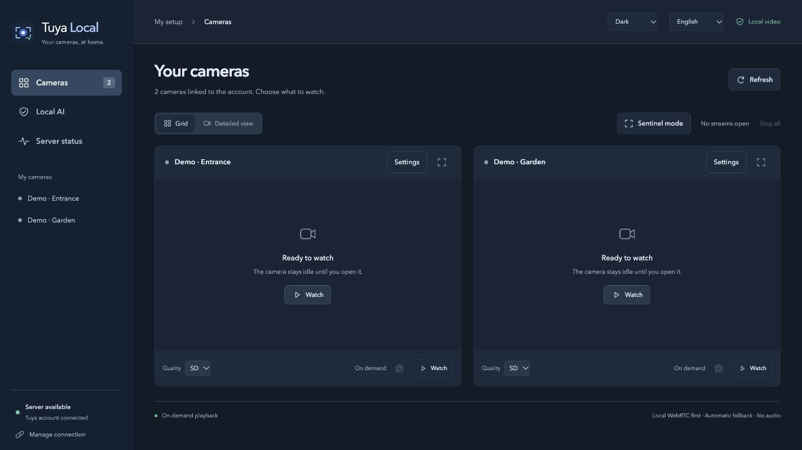

# Tuya Local


A local camera server and **Tauri v2 desktop application** for macOS, Windows and Linux. Docker and desktop share one corrected media engine and one interface.

- Built-in local server or connection to an existing server.
- Local RTSP/WebRTC video, HD/SD and H.264 compatibility fallback.
- Automatic wake-up, camera settings, themes and sentinel display.
- Optional local AI per camera, battery protection and event history.
- French, English, Dutch, German and Spanish interface.



*Documentation preview with synthetic cameras. No private video or account data.*

## Run with Docker

```sh
git clone https://github.com/timiliris/tuya-local.git
cd tuya-local
cp .env.example .env
# Set TUYA_HOST_IP to the Docker host's LAN IPv4 address.
docker compose up -d --build
```

Open [Tuya Local](http://127.0.0.1:18788/) and scan the QR code with Tuya / Smart Life.

## Documentation

**[Wiki](https://github.com/timiliris/tuya-local/wiki)** · [Desktop application](https://github.com/timiliris/tuya-local/wiki/Desktop) · [Docker](https://github.com/timiliris/tuya-local/wiki/Docker) · [Development](https://github.com/timiliris/tuya-local/wiki/Development)

Wiki sources live in `wiki/`. Old guides, translations and installers are preserved through [Archives](https://github.com/timiliris/tuya-local/wiki/Archives).

Video and AI inference stay local; account login, signaling, wake-up and some commands still use Tuya. Set or change the optional web/API password in **Server settings**, without editing configuration files. Localhost access remains the default. See [security and access](https://github.com/timiliris/tuya-local/wiki/Network-and-privacy) before enabling LAN access.

Account sessions, device keys and private thumbnails are excluded from this repository. Based on [DanEng1982/tuya-rtsp-bridge](https://github.com/DanEng1982/tuya-rtsp-bridge), with the [seydx/tuya-ipc-terminal](https://github.com/seydx/tuya-ipc-terminal) engine. Required licenses and attributions: [LICENSE](LICENSE), [NOTICE.md](NOTICE.md).
